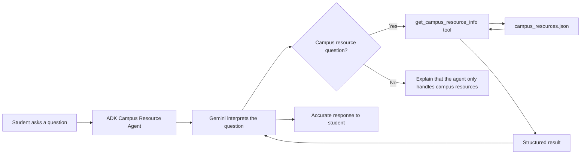

# DESIGN_NOTES.md
## Agent Lab Part 2 — Campus Resource Assistant

### 1. Problem statement

Student Services wants a Campus Resource Assistant that makes it easier for students to find accurate information about college services. Students may not know which office to contact, where a resource is located, or when it is available. The first version of the assistant will let a student ask a question in normal language and receive an answer based on trusted campus information instead of requiring the student to search through multiple web pages.

### 2. Why Gemini cannot answer campus-specific questions by itself

A large language model such as Gemini can answer many general questions because it was trained on large amounts of information, but it does not automatically know private, local, or frequently changing JCC information. Campus office hours, locations, phone numbers, and staff information can change. If Gemini answered from its own memory, it could give outdated or invented information. Giving the agent a Python tool that reads a verified JSON file makes the local data the source of truth.

### 3. Why store campus data in JSON instead of directly in Python?

1. **Separation of data and logic.** Office information can be updated without changing the Python program.
2. **Easy verification.** JSON is human-readable, so an instructor or staff member can review the campus information without understanding the agent code.
3. **Easier future upgrades.** The JSON file could later be replaced by a database, API, or content-management system without redesigning the entire agent.
4. **Git-friendly.** Changes to resource data can be tracked separately from changes to application logic.

### 4. Three limitations and future improvements

**Stale campus data:** Office hours, contact information, and locations can change. A future version could retrieve data from an official JCC API or web feed and keep `last_verified` dates for auditing.

**No long-term conversation memory:** Version 1 does not store conversations in a database. A future version could use an approved persistent session service so students can continue a conversation while still following privacy requirements.

**The model may fail to call the tool:** LLM behavior is probabilistic. The team can improve reliability with clearer agent instructions, a strong tool docstring, automated tests, and test cases that verify campus questions always trigger the lookup tool.

### 5. What happens if the JSON information is inaccurate?

Incorrect data could send a student to the wrong building, cause them to arrive when an office is closed, or give them the wrong contact information. That would reduce trust in the assistant. Campus information should therefore be verified against official JCC sources, and the appropriate college office or designated data owner should be responsible for confirming updates. If a value cannot be verified, the system should identify it as needing review instead of guessing.

## Verified campus resources

| Resource | Location | Hours | Phone | Email | Website | Verified By | Date Verified |
|---|---|---|---|---|---|---|---|
| Cattaraugus County Campus Library | Learning Commons, LLAC, Olean | Current hours vary by semester; official library page shows current hours | 716.376.7517 | Not listed on official contact page | JCC Libraries | SUNY JCC official website | 2026-09-22 |
| Learning Center | LLAC Floor 1, Learning Commons, Olean | Follows Learning Commons schedule; verify current semester hours online | 716.376.7517 | Not listed on official page | JCC Learning Center | SUNY JCC official website | 2026-09-22 |
| Academic Advising / Success Center | COLL Floor 1, Olean | Campus public hours M-F 9 a.m.-5 p.m.; service availability may vary | 716.376.7508 | SuccessCenter@sunyjcc.edu | JCC Success Center | SUNY JCC official website | 2026-09-22 |
| Financial Aid & Billing | COLL Floor 1, Olean | Campus public hours M-F 9 a.m.-5 p.m.; service availability may vary | 716.338.1009 | FinancialAid@sunyjcc.edu | JCC Financial Aid & Billing | SUNY JCC official website | 2026-09-22 |

## Official sources used

- JCC Libraries: https://www.sunyjcc.edu/support/learning-commons/library
- Ask the Libraries: https://www.sunyjcc.edu/support/learning-commons/library/ask
- JCC Learning Center: https://www.sunyjcc.edu/support/learning-commons/learning-center
- JCC Success Center: https://www.sunyjcc.edu/support/success-center
- JCC Advising/Get Connected: https://www.sunyjcc.edu/support/success-center/advising/get-connected
- JCC Financial Aid & Billing: https://www.sunyjcc.edu/support/financial-aid-billing
- JCC Campus Locations & Hours: https://www.sunyjcc.edu/about/locations

## Agent workflow diagram

### Workflow in words

Student question → ADK agent → Gemini decides whether the campus lookup tool is needed → Python tool reads `campus_resources.json` → structured data returns to Gemini → Gemini produces the final answer.
